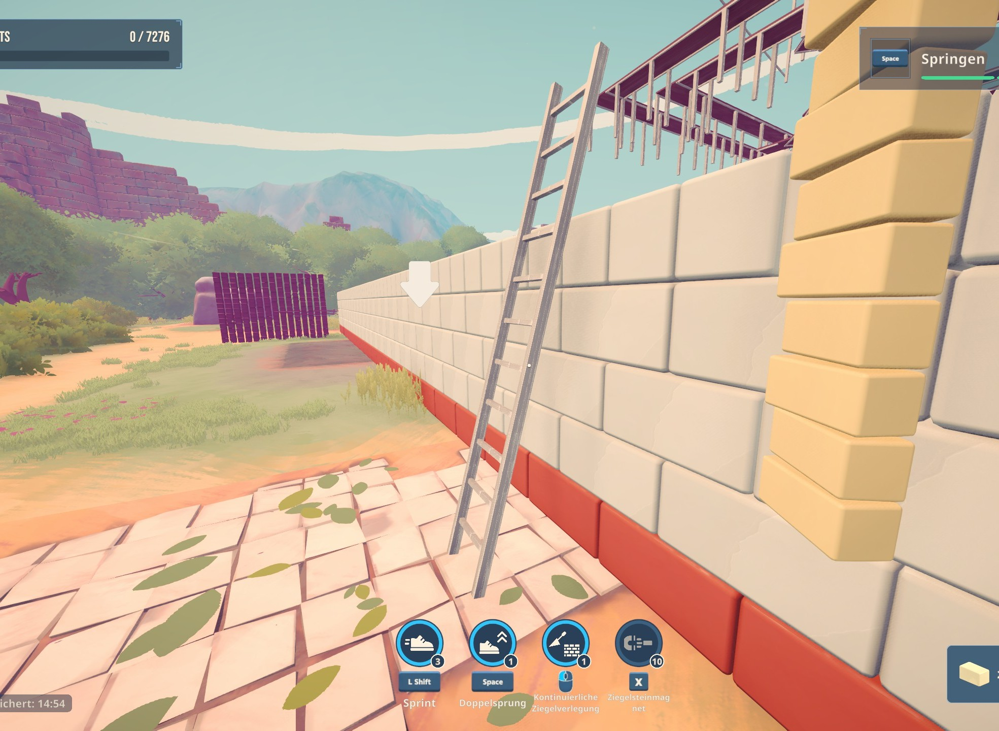
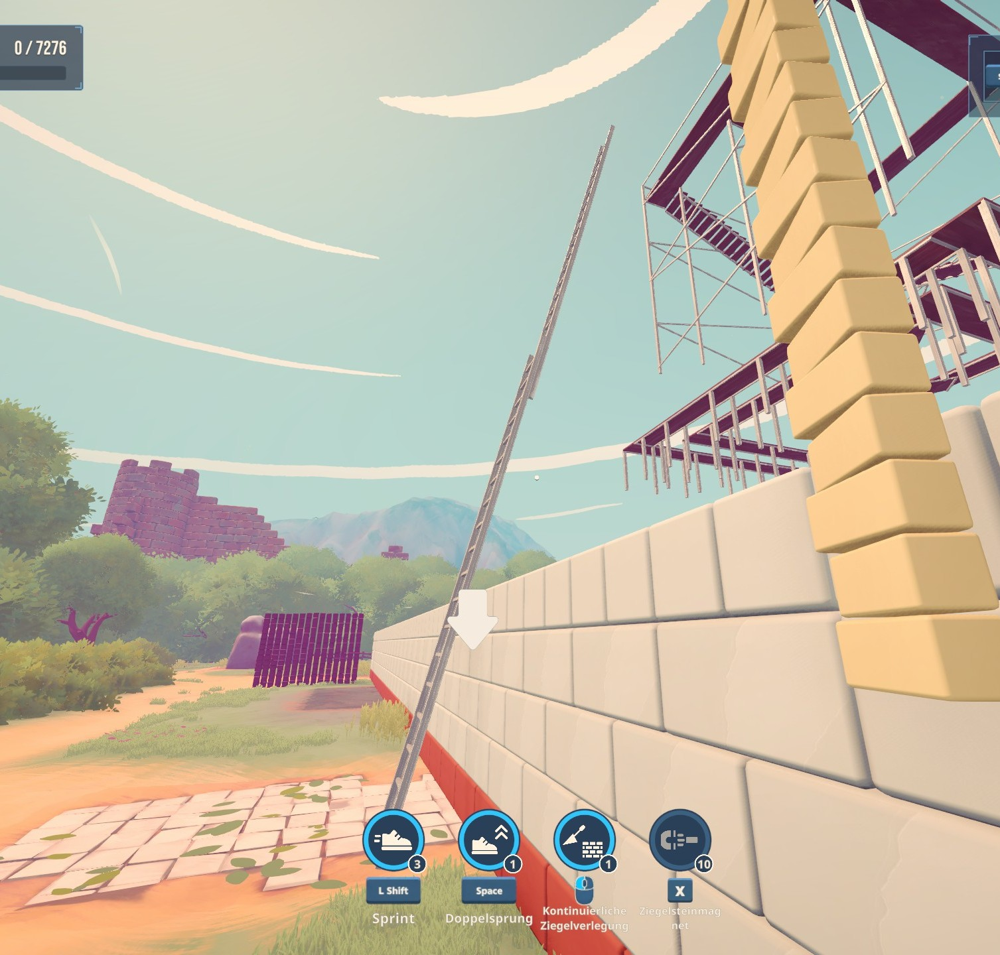
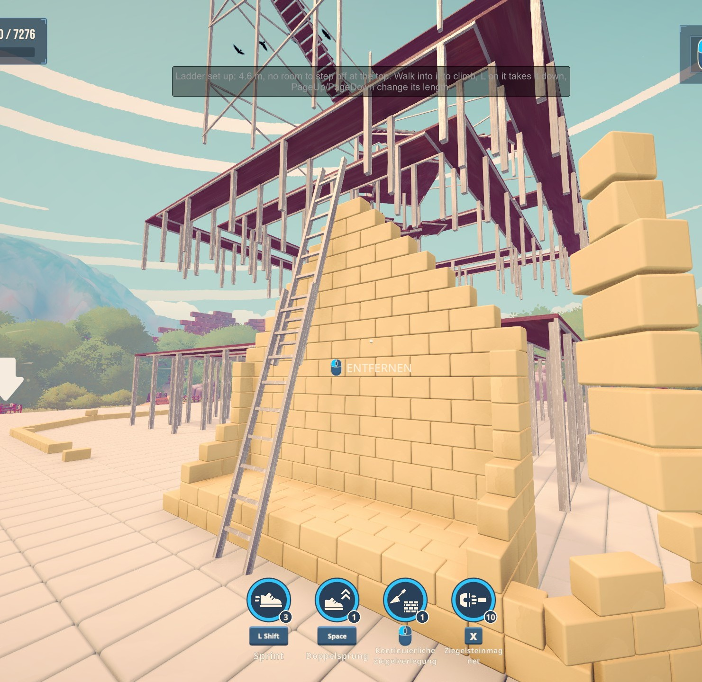

# Brick by Brick – Ladder (Mod)

An extension ladder: set it up against a wall, climb it, set bricks from it and step off at the top. Works in every
world and save slot, with or without other mods.

> Unofficial fan mod, not made by the game's developers. A world in which you set up a ladder no longer counts for the
> Steam leaderboard (the mod marks it as practice, because the ladder replaces the mobile scaffold you would otherwise
> have to unlock).



*Set up against a wall at 75°, reaching about 0.9 m over its top edge.*



*Extended to its full length.*



*Building a wall from the ladder; the message at the top appears when it is set up.*

## Install

1. Download **[ladder-mod.zip](https://github.com/michel86ch-ui/brickbybrick-mod-ladder/raw/main/ladder-mod.zip)**.
2. Unzip everything into the game folder, so that `winhttp.dll` sits next to `BrickByBrick.exe`
   (Steam: right-click the game > Manage > Browse local files). BepInEx already installed (e.g. with
   [Extra Buildings](https://github.com/michel86ch-ui/brickbybrick-mod),
   [SkillPoints](https://github.com/michel86ch-ui/brickbybrick-mod-skillpoints) or
   [SkillModify](https://github.com/michel86ch-ui/brickbybrick-mod-skillmodify))? Just overwrite, the files are the same.

Settings: `BepInEx\config\michel.brickbybrick.ladder.cfg` (created at the first game start).
Uninstall: delete the folder `BepInEx\plugins\Ladder`.

The ZIP contains BepInEx 5.4.23.5 (unmodified, MIT license) and the mod.

## How to use

- **L** while looking at a wall: the ladder leans against it at 75° and extends to about 0.9 m over the wall's top edge
  (up to 12 m). Pressing L at another wall moves it there.
- **L** while looking at the ladder: take it down.
- **Page Up / Page Down**: make it 0.5 m longer or shorter.
- **Climb**: walk into the ladder facing the wall. Forward climbs up while you face the wall (or look along it) and
  down while you face away; jump lets go. At the top you step off onto the surface behind the edge when there is room
  (a roof, a scaffold deck); from there, face outwards and walk forward to climb down again.
- While on the ladder you can look around and set bricks as usual.

## Good to know

- One ladder per player. Only you see it (other players see you climbing).
- The ladder stays where you left it, per world, in `BepInEx\config\michel.brickbybrick.ladder.worlds.json`. The game's
  save is not changed; a new world in the same slot starts without a ladder.
- The ladder has no collider: it blocks neither bricks nor the mobile scaffold.
- Keys, `MaxLength` (3–30 m, default 12) and `ClimbSpeed` (default 2.5 m/s) are in the settings file.

## Building

```
cd src
dotnet build -c Release -p:DeployToGame=true     (copies the DLL into the game)
```

Climbing is a custom movement mode of the game's character controller (ECM2), after the ladder example that ships with
it: the player moves along the ladder's line, and steps over the edge at the top with collisions briefly off.
